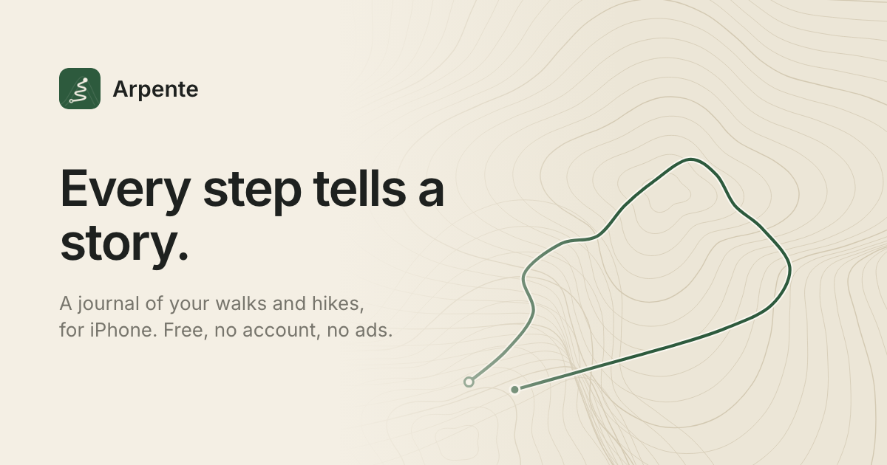

  

<h1 align="center">Arpente</h1>

<strong>Every step tells a story.</strong>

  A journal of your walks and hikes: beautiful GPS maps, clear statistics and the story of your explorations. No account needed.

  <a href="https://arpente.app">arpente.app</a> · <a href="https://arpente.app/fr/">Français</a>

## A journal, not a stopwatch

Arpente is an iPhone app for keeping the walks and hikes that make up your life outside. It isn't a performance app: no rankings, no pace to beat, no feed. You could walk 2 km around your neighborhood or 18 km in the mountains: both are worth keeping.

## What you can do

- **Record in one tap.** Put your iPhone in your pocket: Arpente draws your route with GPS.
- **See it on a beautiful map.** Every exploration keeps its map, with its distance, duration and elevation gain.
- **Keep the day.** A name, a note and a few photos for each exploration.
- **Look back.** Your journal, month by month, your statistics by month and by year, and a map of every place you've explored.
- **Keep your journal yours.** Synced with your private iCloud, and each route exportable as GPX.

## Private by default

No account, no sign-up, no ads. Your routes are stored on your iPhone and in your private iCloud, and never sent to us.

## Download

Arpente is coming soon to the App Store, for iPhone.

---

## En français

**Chaque pas raconte un parcours.**

Arpente est une app iPhone pour garder tes marches et tes randonnées. Pas une app de performance : le journal de tes explorations. Tu pourrais marcher 2 km dans ton quartier ou parcourir 18 km en montagne : les deux méritent d’être conservées.

- **Enregistre d’un toucher** : Arpente trace ton parcours au GPS.
- **Une belle carte pour chaque exploration**, avec sa distance, sa durée et son dénivelé.
- **Garde la journée** : un nom, une note et quelques photos.
- **Regarde le chemin parcouru** : ton journal, tes statistiques et la carte de tous les lieux explorés.
- **Ton journal reste à toi** : synchro iCloud et export GPX. Sans compte, sans pub, gratuite.

[arpente.app/fr](https://arpente.app/fr/)

---

Made with ♥ by <a href="https://wibeset.ca">Wibeset</a> in Canada

